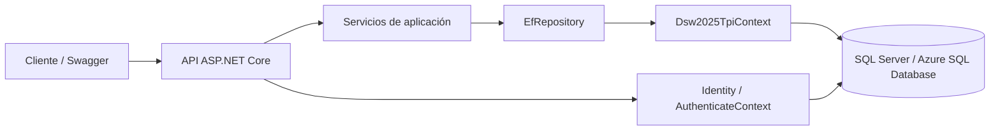
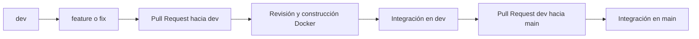
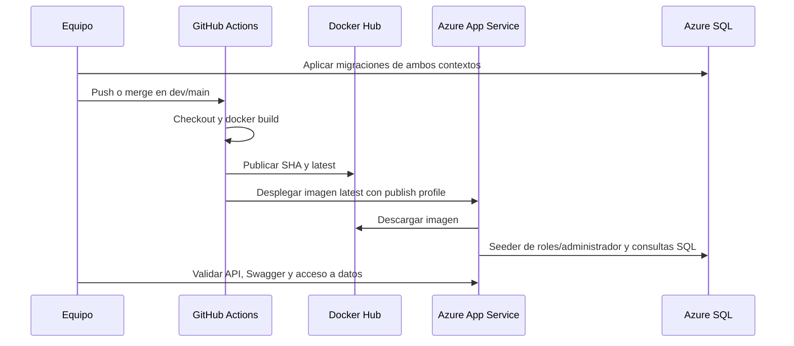

# Documentación del proceso de desarrollo, contenedorización y despliegue

**Proyecto:** Dsw2025Tpi — API de productos, clientes y órdenes.  
**Fecha:** 14 de octubre de 2026.  
**Versión documentada:** rama local `dev`, commit `1b55d45df76381031a7ca1439484c29826ca8b0d`.  
**Repositorio:** [Marchin0145/Dsw2025Tpi](https://github.com/Marchin0145/Dsw2025Tpi).

Este documento explica el recorrido desde un cambio de código hasta la ejecución de la API en un contenedor conectado a SQL Server o Azure SQL Database. Describe los archivos de la versión indicada; las prácticas propuestas se identifican expresamente como recomendaciones. No acredita una ejecución nueva del pipeline ni una comprobación de los recursos de Azure.

## 1. Arquitectura y tecnologías

La solución está organizada en cuatro proyectos .NET 8:

| Proyecto | Responsabilidad |
| --- | --- |
| `Dsw2025Tpi.Api` | Controladores HTTP, configuración de servicios, autenticación JWT, Swagger, arranque y migraciones. |
| `Dsw2025Tpi.Application` | Servicios de productos, órdenes y clientes, DTO, generación de tokens y manejo de excepciones. |
| `Dsw2025Tpi.Domain` | Entidades del negocio e interfaz `IRepository`. |
| `Dsw2025Tpi.Data` | Contextos de Entity Framework Core y repositorio de acceso a datos. |

Se utiliza ASP.NET Core para la API, Entity Framework Core 8 para persistencia, SQL Server como motor de base de datos y ASP.NET Core Identity para usuarios y roles. Docker empaqueta la aplicación; GitHub Actions construye y publica la imagen en Docker Hub y solicita su despliegue en Azure App Service.



Los dos contextos usan la misma cadena de conexión y, por lo tanto, la misma base. El contenedor contiene la API; la base de datos se administra por separado.

## 2. Estrategia de ramificaciones

### 2.1. Ramas y finalidad

El historial local muestra ramas `main`, `dev`, `feature/*` y ramas de correcciones con prefijo `Fix/*`. También conserva ramas de trabajo por integrante. El flujo de integración observado es **rama de trabajo → `dev` → `main`**, mediante Pull Requests.

| Rama | Finalidad dentro del flujo |
| --- | --- |
| `main` | Referencia para versiones integradas y entregables. |
| `dev` | Integración del trabajo del equipo antes de promoverlo a `main`. |
| `feature/<nombre>` | Desarrollo de una funcionalidad o cambio acotado. |
| `fix/<nombre>` | Convención recomendada para correcciones; existen ramas históricas con `Fix/`. |

En este repositorio la rama de integración se llama `dev`. Si una consigna utiliza el nombre `development`, debe aclararse esta equivalencia o acordarse el cambio de nombre y actualizar los workflows.



Ejemplos verificables en el historial: PR #6, `feature/azure-sql-retries` hacia `dev`; PR #7, `dev` hacia `main`; y PR #12, `Fix/Swagger-conectado-con-Azure` hacia `dev`. El historial de merges demuestra integración por PR, pero no permite confirmar las reglas actuales de protección ni la cantidad obligatoria de aprobaciones.

### 2.2. Procedimiento de trabajo

Los siguientes comandos son ejemplos para PowerShell, ejecutados desde la raíz del repositorio:

```powershell
git switch dev
git pull --ff-only origin dev
git switch -c feature/nueva-funcionalidad

# Realizar y revisar los cambios.
git status
git diff
git add <archivos-del-cambio>
git commit -m "feat: describir la funcionalidad"
git push -u origin feature/nueva-funcionalidad
```

Después se abre un PR con destino `dev`, se revisa el cambio y se comprueban los workflows. Una vez integrado y validado el conjunto de cambios, se abre otro PR de `dev` hacia `main`.

Se recomienda proteger ambas ramas, exigir al menos una aprobación de otro integrante y requerir las comprobaciones de CI antes de fusionar. Son criterios propuestos para el equipo, no una afirmación sobre la configuración actual de GitHub.

**Relación con el despliegue actual:** el workflow de despliegue responde a pushes tanto a `dev` como a `main`, utilizando el mismo secreto `APP_SERVICE_NAME`. Por eso, integrar un cambio en cualquiera de las dos ramas puede actualizar la misma Web App. El YAML no separa un entorno de desarrollo de otro de producción.

## 3. Dockerfile y construcción de la imagen

### 3.1. Dockerfile de la versión documentada

El archivo [Dockerfile](Dockerfile) está en la raíz del repositorio:

```dockerfile
FROM mcr.microsoft.com/dotnet/sdk:8.0 AS build
WORKDIR /src
COPY . .
RUN dotnet publish Dsw2025Tpi.Api/Dsw2025Tpi.Api.csproj \
    -c Release -o /app/publish

FROM mcr.microsoft.com/dotnet/aspnet:8.0 AS runtime
WORKDIR /app
ENV ASPNETCORE_URLS=http://+:8080
ENV ASPNETCORE_ENVIRONMENT=Production
EXPOSE 8080
COPY --from=build /app/publish .

ENTRYPOINT ["dotnet", "Dsw2025Tpi.Api.dll"]
```

La construcción tiene dos etapas:

1. **`build`:** utiliza el SDK de .NET 8, copia el código y ejecuta `dotnet publish` en configuración Release. Este comando restaura las dependencias y compila lo necesario para publicar la API en `/app/publish`.
2. **`runtime`:** utiliza ASP.NET Core Runtime 8 y copia únicamente el resultado publicado de la etapa anterior. Al iniciar el contenedor ejecuta `Dsw2025Tpi.Api.dll`.

`ASPNETCORE_URLS=http://+:8080` hace que la API escuche en el puerto 8080 en las interfaces del contenedor. `EXPOSE 8080` declara ese puerto, pero la publicación en la máquina anfitriona se realiza con `docker run -p`. El entorno predeterminado es `Production` y puede sobrescribirse al ejecutar el contenedor.

El Dockerfile actual no incluye una instrucción `USER` que seleccione explícitamente un usuario sin privilegios, ni un `HEALTHCHECK` de Docker. El endpoint HTTP `/healthcheck` se configura en la aplicación.

### 3.2. Archivos excluidos

El archivo [.dockerignore](.dockerignore) excluye:

```text
.git
.vs
**/bin
**/obj
```

Esto evita enviar el historial Git y los resultados locales de compilación al contexto de construcción. Los archivos `appsettings*.json` no están excluidos por estas reglas; la configuración de desarrollo incluida en el proyecto debe tratarse como configuración de ejemplo. Los valores reales de producción se suministran externamente.

### 3.3. Construcción local

Con Docker instalado y su motor en ejecución, desde la raíz:

```powershell
docker build -t dsw2025tpi-api:local -f Dockerfile .
docker image inspect dsw2025tpi-api:local
```

La construcción correcta demuestra que el código puede publicarse dentro de la imagen. La conexión a SQL y las variables requeridas se verifican al ejecutar la API.

## 4. Conexión entre API y base de datos

### 4.1. Configuración de los contextos

En [Program.cs](Dsw2025Tpi.Api/Program.cs), ambos contextos se registran mediante `AddDbContext` y `UseSqlServer`. El siguiente fragmento resume la configuración existente:

```csharp
builder.Services.AddDbContext<Dsw2025TpiContext>(options =>
    options.UseSqlServer(
        builder.Configuration.GetConnectionString("Dsw2025Tpi"),
        sql =>
        {
            sql.MigrationsAssembly("Dsw2025Tpi.Api");
            sql.EnableRetryOnFailure();
        }));

builder.Services.AddDbContext<AuthenticateContext>(options =>
    options.UseSqlServer(
        builder.Configuration.GetConnectionString("Dsw2025Tpi"),
        sql =>
        {
            sql.MigrationsAssembly("Dsw2025Tpi.Api");
            sql.EnableRetryOnFailure();
        }));
```

`GetConnectionString("Dsw2025Tpi")` obtiene `ConnectionStrings:Dsw2025Tpi`. En variables de entorno, ese nombre se representa como **`ConnectionStrings__Dsw2025Tpi`**. Las variables de entorno sobrescriben los valores equivalentes de los archivos de configuración con la configuración predeterminada usada por la aplicación.

`EnableRetryOnFailure()` habilita reintentos del proveedor SQL ante fallos transitorios. No soluciona credenciales incorrectas, falta de permisos, esquemas ausentes o reglas de firewall que bloquean el acceso.

### 4.2. Datos administrados

| Contexto | Datos y tablas |
| --- | --- |
| `Dsw2025TpiContext` | `Products`, `Customers`, `Orders` y `OrderItems`. |
| `AuthenticateContext` | `Usuarios`, `Roles`, `UsuarioRoles`, `UsuarioClaims`, `UsuarioLogins`, `RoleClaims` y `UsuarioTokens`. |

Las órdenes se relacionan con clientes y sus ítems se relacionan con productos. Identity administra las credenciales y roles de la aplicación. Un cliente del negocio y un usuario de Identity son registros diferentes.

Para una consulta de productos, el recorrido es:

1. El cliente envía `GET /api/products`.
2. `ProductController` llama a `ProductServices`.
3. El servicio utiliza `IRepository`, registrado como `EfRepository`.
4. El repositorio consulta `Dsw2025TpiContext` y EF Core ejecuta SQL contra la base configurada.
5. La API transforma el resultado y devuelve la respuesta HTTP.

Las escrituras del repositorio llaman a `SaveChangesAsync()`. El inicio de sesión consulta usuarios mediante Identity y `AuthenticateContext`, y genera un token JWT si las credenciales son válidas.

### 4.3. Cadena de conexión

Ejemplo para Azure SQL, con marcadores que deben reemplazarse:

```text
$env:ConnectionStrings__Dsw2025Tpi = 'Server=tcp:<servidor>.database.windows.net,1433;Initial Catalog=<base>;User ID=<usuario-sql>;Password=<contraseña-sql>;Encrypt=True;TrustServerCertificate=False;Connection Timeout=30;'
```

La base debe existir, el usuario SQL debe tener permisos y las reglas de red deben permitir el acceso desde el equipo que aplica migraciones y desde la Web App. La API necesita poder resolver el servidor y alcanzar el puerto SQL configurado.

### 4.4. Variables de ejecución

| Variable | Finalidad |
| --- | --- |
| `ASPNETCORE_ENVIRONMENT` | Entorno; el Dockerfile define `Production`. |
| `ASPNETCORE_URLS` | Dirección de escucha; el Dockerfile define `http://+:8080`. |
| `ConnectionStrings__Dsw2025Tpi` | Cadena SQL compartida por ambos contextos. |
| `Jwt__key` | Clave de firma de tokens; usar una clave aleatoria de al menos 32 bytes para HS256. |
| `Jwt__issuer` | Emisor esperado del token. |
| `Jwt__Audience` | Audiencia esperada del token. |
| `Jwt__ExpireInMinutes` | Duración del token; el servicio usa 60 si no se configura. |
| `AdminUser__Email` | Correo del administrador inicial. |
| `AdminUser__Password` | Contraseña del administrador inicial, compatible con las reglas de Identity. |

Fuera de `Development`, el código exige `AdminUser__Email` y `AdminUser__Password` antes de continuar con el arranque. También necesita configuración JWT y SQL válida para operar. El archivo `appsettings.json` no contiene esos valores de producción.

## 5. Creación del esquema y migraciones

Las migraciones se encuentran en `Dsw2025Tpi.Api/Migrations`; las de Identity están dentro de `Migrations/Authenticate`.

El arranque de la aplicación **no ejecuta `Database.Migrate()` ni crea automáticamente el esquema**. El seeder intenta crear roles y el administrador utilizando tablas que deben existir. Sus excepciones se registran en logs; por eso la API puede llegar a responder aunque haya fallado esa inicialización.

Los factories de [DesignTimeDbContextFactories.cs](Dsw2025Tpi.Api/DesignTimeDbContextFactories.cs) permiten aplicar migraciones sin iniciar la API. Obtienen la conexión directamente de `ConnectionStrings__Dsw2025Tpi`; no leen la cadena de `appsettings.Development.json`.

Desde PowerShell, con .NET 8 SDK disponible:

```powershell
# Instalar una vez una versión de la herramienta compatible con EF Core del proyecto.
dotnet tool install --global dotnet-ef --version 8.0.18
dotnet restore Dsw2025Tpi.sln

# Sustituir los marcadores antes de ejecutar. No versionar credenciales.
$env:ConnectionStrings__Dsw2025Tpi = 'Server=tcp:<servidor>.database.windows.net,1433;Initial Catalog=<base>;User ID=<usuario-sql>;Password=<contraseña-sql>;Encrypt=True;TrustServerCertificate=False;Connection Timeout=30;'

dotnet ef database update --context Dsw2025TpiContext --project Dsw2025Tpi.Api --startup-project Dsw2025Tpi.Api
dotnet ef database update --context AuthenticateContext --project Dsw2025Tpi.Api --startup-project Dsw2025Tpi.Api
```

Si `dotnet-ef` ya está instalado, comprobar su versión con `dotnet ef --version` y utilizar una versión compatible de la serie 8. Las dos actualizaciones son necesarias: una crea o actualiza las tablas del negocio y la otra las de autenticación.

Como alternativa para revisión previa, pueden generarse scripts SQL idempotentes con `dotnet ef migrations script --idempotent`, indicando el mismo `--context`, `--project` y `--startup-project` para cada contexto. El pipeline actual no ejecuta estas migraciones.


## 6. Pipeline de integración y despliegue

El repositorio contiene dos workflows independientes. Ambos construyen imágenes en ciertos eventos; no existe una dependencia que obligue al workflow de despliegue a esperar al workflow `Docker Image CI`.

### 6.1. Workflow de construcción Docker

Archivo: [.github/workflows/docker-image.yml](.github/workflows/docker-image.yml).  
Nombre: `Docker Image CI`.

Se ejecuta con pushes a `dev` y PR cuyo destino sea `dev`. En `ubuntu-latest`, descarga el repositorio con `actions/checkout@v4` y ejecuta:

```bash
docker build . --file Dockerfile --tag my-image-name:$(date +%s)
```

Construye una imagen con una etiqueta basada en el momento de ejecución. No la publica en un registro ni la despliega.

### 6.2. Workflow de publicación y despliegue

Archivo: [.github/workflows/deploy.yml](.github/workflows/deploy.yml).  
Nombre: `Build and Deploy to Azure App Service (Publish Profile)`.

Eventos definidos:

```yaml
on:
  push:
    branches: [dev, main]
  pull_request:
    branches: [dev, main]
  workflow_dispatch:
```

El job `build-and-deploy`, ejecutado en `ubuntu-latest`, realiza:

| Paso | Acción | Cuándo se ejecuta |
| --- | --- | --- |
| 1 | Descargar código con `actions/checkout@v4`. | En todos los eventos definidos. |
| 2 | Iniciar sesión en Docker Hub con `docker/login-action@v3`. | En todos los eventos, incluidos PR. |
| 3 | Construir la imagen con etiquetas SHA y `latest`. | En todos los eventos, si los pasos previos pasan. |
| 4 | Publicar ambas etiquetas con `docker push`. | Cuando el evento no es `pull_request`. |
| 5 | Desplegar con `azure/webapps-deploy@v3`. | Cuando el evento no es `pull_request`. |

La imagen se llama `dsw2025tpi-api`. La construcción utiliza:

```bash
docker build \
  -t ${{ secrets.DOCKERHUB_USERNAME }}/dsw2025tpi-api:${{ github.sha }} \
  -t ${{ secrets.DOCKERHUB_USERNAME }}/dsw2025tpi-api:latest \
  -f Dockerfile \
  .
```

La etiqueta `${{ github.sha }}` permite identificar el commit asociado al evento. `latest` es mutable y se actualiza con cada publicación. El paso de despliegue utiliza **`latest`**, no la etiqueta SHA:

```yaml
- name: 5. Desplegar el contenedor en Azure App Service
  if: github.event_name != 'pull_request'
  uses: azure/webapps-deploy@v3
  with:
    app-name: ${{ secrets.APP_SERVICE_NAME }}
    publish-profile: ${{ secrets.AZURE_WEBAPP_PUBLISH_PROFILE }}
    images: ${{ secrets.DOCKERHUB_USERNAME }}/${{ env.IMAGE_NAME }}:latest
```

### 6.3. Secretos requeridos en GitHub Actions

Se configuran en los secretos de Actions del repositorio:

| Secreto | Uso |
| --- | --- |
| `DOCKERHUB_USERNAME` | Usuario o espacio de nombres de Docker Hub utilizado para publicar la imagen. |
| `DOCKERHUB_TOKEN` | Token con permisos de publicación en ese repositorio de imágenes. |
| `APP_SERVICE_NAME` | Nombre de la Web App de Azure que recibirá el despliegue. |
| `AZURE_WEBAPP_PUBLISH_PROFILE` | Contenido del perfil de publicación que autentica el despliegue en Azure. |

El YAML declara también `REGISTRY: ${{ secrets.ACR_NAME }}.azurecr.io`, pero esa variable no se utiliza en los pasos. La publicación efectiva se hace en Docker Hub; `ACR_NAME` no interviene en ese recorrido.

La conexión SQL y las claves JWT se configuran en el entorno de ejecución de la Web App. El workflow no las transmite mediante `docker build`.

### 6.4. Alcance y comportamiento actual

- La compilación se realiza mediante `dotnet publish` dentro del Dockerfile. El workflow actual no tiene pasos independientes `dotnet restore`, `dotnet build` o `dotnet test`.
- La carpeta `test/` contiene cuerpos JSON para casos de prueba manuales; la solución no incluye un proyecto de pruebas automatizadas.
- No se aplican migraciones ni se realizan solicitudes HTTP después del despliegue.
- Los PR no publican ni despliegan, pero intentan iniciar sesión en Docker Hub. Los PR desde forks normalmente no reciben los secretos y pueden fallar en ese paso. Véase la [documentación de eventos y secretos de GitHub](https://docs.github.com/en/actions/reference/workflows-and-actions/events-that-trigger-workflows).
- Pushes a `dev` y `main` publican el mismo nombre de imagen y despliegan en la misma Web App. Una ejecución manual también publica y despliega si supera los pasos anteriores, ya que la condición sólo excluye PR.

Como mejoras del flujo, se recomienda separar los entornos por rama o reservar el despliegue de producción para `main`, omitir el login en PR cuando sólo se valida la construcción, desplegar la etiqueta SHA y agregar pruebas HTTP de aplicación y SQL. Estas mejoras no forman parte del YAML documentado.

## 7. Preparación y despliegue en Azure

### 7.1. Recursos y configuración

Antes del primer despliegue deben estar preparados:

1. Una base Azure SQL Database y su servidor, usuario, permisos y reglas de acceso de red.
2. El esquema de ambos contextos, aplicado mediante las migraciones de la sección 5.
3. Una Azure App Service Web App configurada para ejecutar el contenedor Linux.
4. Un repositorio Docker Hub al que pueda publicar GitHub Actions y del que pueda descargar Azure.
5. Los cuatro secretos utilizados por el workflow.

En la Web App se configuran las variables de la sección 4.4, con entorno `Production` y conexión a Azure SQL. El puerto de destino debe coincidir con **8080**. En App Service con configuración clásica de contenedor se utiliza `WEBSITES_PORT=8080`; si el recurso utiliza configuración con sidecar, se define el puerto de destino en la configuración del contenedor.

### 7.2. Secuencia de despliegue



Una ejecución exitosa del paso de despliegue debe complementarse con pruebas funcionales. El pipeline actual no acredita por sí solo que la conexión SQL o el inicio de sesión estén funcionando.

## 8. Validación de la entrega

Reemplazar el dominio de ejemplo por el dominio real de la Web App:

```powershell
$apiBaseUrl = '[https://<dominio-real-de-la-web-app>](https://techogar-bjh4hka0ftfhahaj.chilecentral-01.azurewebsites.net/)'
curl.exe -i "$apiBaseUrl/healthcheck"
curl.exe -i "$apiBaseUrl/swagger/v1/swagger.json"
curl.exe -i "$apiBaseUrl/api/products"
```

| Comprobación | Resultado a registrar |
| --- | --- |
| Construcción Docker | Comando o ejecución de Actions exitosa y commit construido. |
| Migraciones | Actualización exitosa de `Dsw2025TpiContext` y `AuthenticateContext`. |
| Contenedor | Estado de ejecución y logs de arranque. |
| `/healthcheck` | Respuesta satisfactoria del proceso; no demuestra acceso SQL. |
| `/swagger/v1/swagger.json` y `/swagger` | Documento OpenAPI e interfaz accesibles. |
| `GET /api/products` | Consulta SQL correcta: `200` con productos o una lista vacía. |
| `POST /login` | Inicio de sesión correcto y emisión de un token, sin publicar su valor. |
| Operaciones protegidas | Uso de `Authorization: Bearer <token>` con el rol requerido. |

Para Swagger, la definición existente usa un campo de tipo `ApiKey` para el encabezado `Authorization`; se introduce `Bearer`, un espacio y el token. En el código actual, crear una orden exige rol `Customer` y registrar empleados exige `Admin`; no todos los endpoints tienen autorización habilitada.

La ruta implementada para actualizar el estado de una orden es **`PUT /api/orders/{id}`**. Debe utilizarse esa ruta al validar esta versión, aunque el README histórico mencione una terminación `/status`.

Para dejar trazabilidad, registrar rama, commit, PR, URL de la ejecución de Actions, etiqueta SHA de la imagen, dominio público, fecha y resultados de las solicitudes. Omitir contraseñas y tokens en capturas y logs compartidos.
